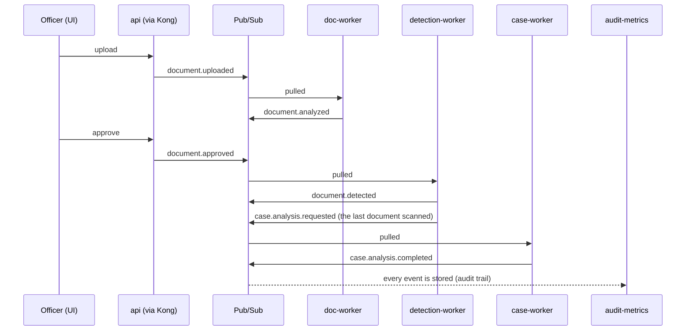

# Presenting the cloud architecture

What we built, how it works, and how to show it. Diagrams: [`six-sevens-architecture.drawio`](six-sevens-architecture.drawio), one page each: 1 System architecture, 2 GCP infrastructure, 3 Life of a document, 4 Stuck work recovery, 5 Observability and cost, 6 CI and deploy. They show the end state: GKE only (Cloud Run removed in phase 6) and Claude through Vertex AI.

- **Open:** VS Code "Draw.io Integration" (`hediet.vscode-drawio`), or app.diagrams.net → File → Open from → Device. For slides, File → Export as PNG/SVG.
- **Change:** edit `build_diagrams.py` and run `python docs/architecture/build_diagrams.py docs/architecture/six-sevens-architecture.drawio` from the repo root. Edits made in draw.io are lost on the next run.

Details: `CLOUD_ARCHITECTURE_PLAN.md` (design), `HOW_IT_WORKS.md` (behaviour), `deploy/terraform/README.md` (operations).

## 1. The one-minute version

The backend is **services that never call each other**: they talk only through **events on one Pub/Sub topic** and shared state in Supabase.

1. An officer's upload or approval becomes an event.
2. Workers pull their events: doc-worker classifies and extracts; detection-worker runs the detection agents; case-worker scores the case.
3. Each worker publishes its result as another event.
4. audit-metrics stores every event: a full audit trail for free.

It runs on **GKE Autopilot** in Singapore, behind **one load balancer with Cloud Armor** and **Kong**. Every service is internal; workers take no inbound traffic and **KEDA** scales them on their backlog. Releases go through **Cloud Deploy** from a **Helm chart**, and only **signed images** run (Binary Authorization). Claude is called through **Vertex AI** with each worker's own Google identity, so there's no model key. Everything is **Terraform**, and **Grafana, Managed Prometheus and Cloud Trace** watch it.

## 2. What to show (about 15 minutes)

| # | Show | Where | Point |
|---|---|---|---|
| 1 | Diagram page 1 | draw.io | Services, one topic, no direct calls; workers private |
| 2 | Upload and approve; the analysis starts on its own | the app | Same app, but each step is an event |
| 3 | Workloads and namespaces | Console → Kubernetes Engine → Workloads | A namespace per service; each scales alone |
| 4 | Pub/Sub subscriptions | Console → Pub/Sub | Each worker pulls only its events; failures go to dead letters |
| 5 | The case's **Claude Cost** tab | case page | Cost per document and analysis, and what caching saved |
| 6 | One trace for that upload | Console → Trace explorer | One trace across api → Pub/Sub → workers |
| 7 | Grafana: Pipeline, Agents, Cost | grafana.sixsevens.me | Stage times, per-agent cost, cache hits, billed cost |
| 8 | Diagram page 4, then the recovery row | draw.io, Grafana | Stuck work recovers itself |
| 9 | Diagram page 6 and a release | GitHub → Actions, Console → Cloud Deploy | Every push tested and scanned; signed images; a failed verify rolls back |
| 10 | `deploy/terraform/` and `deploy/helm/` | repo | All of it is code |

**Optional failure demo** (prepare beforehand): start a detection, then delete the detection-worker pod. Its message is never acknowledged, so Pub/Sub redelivers it to the replacement pod; the audit trail shows the rerun.

## 3. The services

| Service | Reachable? | Does | Triggered by |
|---|---|---|---|
| **Load balancer + Cloud Armor** | public | TLS, OWASP rules, per-address rate limits; `sixsevens.me`, `api.`, `grafana.` | HTTPS |
| **Kong** | from the load balancer only | CORS, rate limits, request ids; blocks `/push` and `/metrics` | HTTP |
| **api** | via Kong | Reads, login, officer commands, uploads, live updates, case match | HTTP |
| **audit-metrics** | via Kong (`/audit`) | Stores every event; audit trail and costs; the sweeper | Every event |
| **doc-worker** | no inbound traffic | OCR, classify, extract | `document.uploaded`, `retyped`, `retry_requested`, `cancelled` |
| **detection-worker** | no inbound traffic | Lead + 3 specialists over 13 checks | `document.approved`, detection retry and cancel |
| **case-worker** | no inbound traffic | Case analysis, risk score, adverse-media search, summary | `case.analysis.requested` |

Also deployed: the **frontend** (nginx) and **Grafana**. Every backend service is the same code with a different `ROLE`; locally one `uvicorn` runs them all.

## 4. How a request flows (page 3)

Live updates: Supabase Realtime tells api a row changed; api pushes a fresh snapshot over the WebSocket.

## 5. The cloud-native requirements

| Requirement | How |
|---|---|
| Decoupled | No service calls another; the contract is the event on one topic |
| Independent scaling | A namespace and deployment per service; KEDA scales workers on undelivered messages |
| Resilience | Redelivery of unacknowledged messages, dead letters after 5 tries, idempotent compare-and-swap handlers, the sweeper, graceful pod shutdown, automatic rollback |
| Infrastructure as code | Terraform for the cloud; a Helm chart for everything in the cluster, with values generated from one roles file |
| Network isolation | One public load balancer; Cloud Armor; internal services; default-deny network policies |
| Secure delivery | ruff, pyright, pytest, Playwright, Checkov, dependency audits; signed images with an SBOM; Binary Authorization enforces; keyless deploys |
| Least privilege | Workload Identity, one Google account per service; secrets mounted from Secret Manager; no model key (Vertex AI) |
| Observability | Metrics, cross-service traces, 4 dashboards, email alerts, audit trail |
| Cost awareness | Claude cost per agent, document and case; billed GCP cost; budget and Claude-spend alerts |

## 6. Questions you may be asked

| Question | Answer |
|---|---|
| Why Pub/Sub, not direct calls? | Calls tie availability together. With events, work waits until the worker is back, and a 1–2 minute detection doesn't hold a request open |
| Why Kubernetes and not Cloud Run? | Load didn't force it (detection p95 92 s). It gives portability (the same Helm chart runs on a bank's own cluster), network isolation, no request-time ceiling for pull workers, and supply-chain control |
| Why one codebase for many services? | Shared models without a library release process. The boundary is the event; each service still has its own image, scaling, identity and release |
| A worker crashes mid-run? | Its message is never acknowledged, so Pub/Sub redelivers it; if the document is still stuck, the sweeper asks its owner to recover it (up to 3 times), then marks it failed for the officer |
| An event processed twice? | Status changes are compare-and-swap, so the repeat does nothing; the audit trail ignores repeated ids |
| How do you know only your code runs? | CI signs each image and attaches its SBOM; Binary Authorization admits only attested images |
| How do you know the cost? | Every Claude call is priced and recorded per run; the Cost dashboard shows billed cost too |
| What's not done? | A shared Anthropic rate limit, staging (decided against), and `PENDING_WORK.md` |

## 7. Limits to state upfront

- All test documents are synthetic (GLDB can't share real ones).
- Claude calls leave Singapore (Vertex AI serves the Claude models from `global`); the cluster, registry and stored data stay in Singapore.
- Claude cost uses list prices; billed cost is exact but hours behind.
- One cluster and no staging; the lean profile runs one replica of most services, which a bank would raise to two.

## 8. Key facts

- `asia-southeast1`, project `fyp-six-sevens`, one regional GKE Autopilot cluster.
- 8 workloads: 5 backend roles, Kong, frontend and Grafana; a namespace each.
- 1 topic, 4 filtered pull subscriptions, a dead-letter topic, a sweep every 5 minutes.
- 4 Grafana dashboards, 4 alert policies.

## 9. The diagrams, page by page

Colours: **purple** front door (load balancer, Kong); **blue** internal service; **yellow** private worker; **orange** Pub/Sub topic; **green** data store; **grey dashed** outside service; **white with a blue edge** Google Cloud service. Dashed arrows are data reads/writes; solid arrows are requests and events.

- **Page 1, System architecture** (start here). Top: browser → load balancer with Cloud Armor → Kong → api and audit-metrics (the frontend straight from the load balancer). Middle: the one topic. Below: the three workers, each arrow labelled with the events it pulls and publishes; KEDA scales them. Around: Supabase, Claude on Vertex AI, dead letters, registries, the scheduler. *Point:* no arrow from one service to another.
- **Page 2, GCP infrastructure.** Management tools on top; the load balancer; the Singapore cluster with a namespace per service; Pub/Sub under it; Cloud NAT for traffic to Supabase and the registries; the managed services along the bottom (Scheduler, Artifact Registry, Binary Authorization, Secret Manager, Monitoring, BigQuery, Trace). *Point:* one public entry, private everything else, no stored keys.
- **Page 3, Life of a document:** 22 numbered steps, top to bottom. Dashed arrows are live updates (steps 8–9, 21–22). Approval writes `approved` before publishing and undoes it if the publish fails (steps 11–12). *Point:* every step is an event, one trace end to end.
- **Page 4, Stuck work recovery:** scheduler → sweeper finds overdue work → one `recovery.requested` per item on the same topic, filtered to its owner → owner reruns (case analysis is marked failed instead: reruns cost Claude calls) → outcomes in the audit trail, email after 3 failed tries. *Point:* self-healing with no database change.
- **Page 5, Observability and cost:** sources (metrics, spans) → stores (Managed Prometheus, Trace, BigQuery billing, `audit_events`) → readers (Grafana, alerts, the Claude Cost tab). *Point:* cost per agent, document and case, beside Google's bill.
- **Page 6, CI and deploy:** three CI jobs in parallel (backend, frontend, security), and the Helm chart's own checks on chart changes. Green on `main` starts the deploy: keyless sign-in, 8 images, sign and attest, render the chart by digest, a Cloud Deploy release, verify through the load balancer, and rollback to the last good release on failure. *Point:* only signed images reach production, and every release is recorded and reversible.
