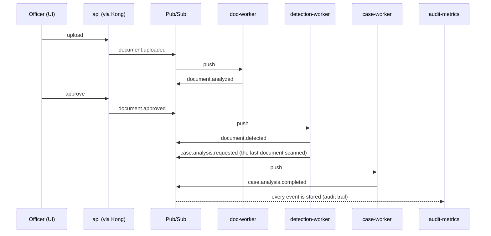

# Presenting the cloud architecture

What we built, how it works, and how to show it. Diagrams: [`six-sevens-architecture.drawio`](six-sevens-architecture.drawio), one page each: 1 System architecture, 2 GCP infrastructure, 3 Life of a document, 4 Stuck work recovery, 5 Observability and cost, 6 CI and deploy.

- **Open:** VS Code "Draw.io Integration" (`hediet.vscode-drawio`), or app.diagrams.net → File → Open from → Device. For slides, File → Export as PNG/SVG.
- **Change:** edit `build_diagrams.py` and run `python docs/architecture/build_diagrams.py docs/architecture/six-sevens-architecture.drawio` from the repo root. Edits made in draw.io are lost on the next run.

Details: `CLOUD_ARCHITECTURE_PLAN.md` (design), `HOW_IT_WORKS.md` (behaviour), `deploy/terraform/README.md` (operations).

## 1. The one-minute version

The backend was one process doing everything. It's now **services that never call each other**: they talk only through **events on one Pub/Sub topic** and shared state in Supabase.

1. An officer's upload or approval becomes an event.
2. Workers pick up their events: doc-worker classifies and extracts; detection-worker runs the fraud agents; case-worker scores the case.
3. Each worker publishes its result as another event.
4. audit-metrics stores every event: a full audit trail for free.

It runs on **Cloud Run**, defined in **Terraform**, with **Kong** as the only front door, keyless deploys from **GitHub Actions**, and **Grafana, Managed Prometheus and Cloud Trace** for monitoring. A Helm chart (planned) would let a bank run the same services on its own Kubernetes.

## 2. What to show (about 15 minutes)

| # | Show | Where | Point |
|---|---|---|---|
| 1 | Diagram page 1 | draw.io | Services, one topic, no direct calls; workers private |
| 2 | Upload and approve; the analysis starts on its own | the app | Same app, but each step is an event |
| 3 | Cloud Run service list | Console → Cloud Run | Each deploys and scales alone, to zero |
| 4 | Pub/Sub subscriptions | Console → Pub/Sub | Each worker gets only its events; failures go to dead letters |
| 5 | The case's **Claude Cost** tab | case page | Cost per document and analysis, and what caching saved |
| 6 | One trace for that upload | Console → Trace explorer | One trace across api → Pub/Sub → workers |
| 7 | Grafana: Pipeline, Agents, Cost | Grafana | Stage times, per-agent cost, cache hits, billed cost |
| 8 | Diagram page 4, then the recovery row | draw.io, Grafana | Stuck work recovers itself |
| 9 | Diagram page 6 and a deploy run | GitHub → Actions | Every push tested and scanned; a bad deploy rolls back |
| 10 | `deploy/terraform/` | repo | All of it is code |

**Optional failure demo** (prepare beforehand; up to ~17 min): start a detection, then deploy or stop the detection-worker. The document returns to "detected" untouched; the audit trail shows `recovery.requested` then `document.recovered`.

## 3. The services

| Service | Public? | Does | Triggered by |
|---|---|---|---|
| **api** | via Kong | Reads, login, officer commands, uploads, live updates, case match | HTTP |
| **audit-metrics** | via Kong (`/audit`) | Stores every event; audit trail and costs; the sweeper | Every event |
| **doc-worker** | private | OCR, classify, extract | `document.uploaded`, `retyped`, `retry_requested`, `cancelled` |
| **detection-worker** | private | Lead + 3 specialists over 13 checks | `document.approved`, detection retry and cancel |
| **case-worker** | private | Case analysis, risk score, adverse-media search, summary | `case.analysis.requested` |
| **Kong** | public | CORS, rate limits, request ids; blocks `/push` and `/metrics` | HTTP |

Also deployed: the **frontend** (nginx) and **Grafana**. Every backend service is the same code with a different `ROLE`; locally one `uvicorn` runs them all.

## 4. How a request flows (page 3)

Live updates: Supabase Realtime tells api a row changed; api pushes a fresh snapshot over the WebSocket.

## 5. The cloud-native requirements

| Requirement | How |
|---|---|
| Decoupled | No service calls another; the contract is the event on one topic |
| Independent scaling | Cloud Run per service; workers 2 vCPU / 4 GiB; all scale to zero |
| Resilience | Redelivery, dead letters after 5 tries, idempotent compare-and-swap handlers, the sweeper, automatic rollback |
| Infrastructure as code | Terraform for services, IAM, secrets, Pub/Sub, scheduler, monitoring, billing, Grafana |
| Secure delivery | ruff, pyright, pytest, Playwright, Checkov, dependency audits, Terraform checks; keyless deploys |
| Least privilege | One account per service; scoped secrets; workers callable only by Pub/Sub |
| Observability | Metrics, cross-service traces, 4 dashboards, email alerts, audit trail |
| Cost awareness | Claude cost per agent, document and case; billed GCP cost; budget and Claude-spend alerts |

## 6. Questions for the professor

1. Does Cloud Run with Pub/Sub count as "genuinely decoupled" for the Cloud Native award, or must Kubernetes actually run?
2. Lead the demo with the event-driven design or the infrastructure?
3. Is the self-recovery demo worth the time slot?

## 7. Questions you may be asked

| Question | Answer |
|---|---|
| Why Pub/Sub, not direct calls? | Calls tie availability together. With events, work waits until the worker is back, and a 1–2 minute detection doesn't hold a request open |
| Why one codebase for many services? | Shared models without a library release process. The boundary is the event; each service still has its own image, scaling, identity and deploy |
| A worker crashes mid-run? | Pub/Sub redelivers; if the document is still stuck, the sweeper asks its owner to recover it (up to 3 times), then marks it failed for the officer |
| An event processed twice? | Status changes are compare-and-swap, so the repeat does nothing; the audit trail ignores repeated ids |
| Why not Kubernetes now? | Same separation for less effort, and load doesn't need more (detection p95 92 s vs a 600 s limit). A tested Helm chart is the plan for a bank's platform |
| How do you know the cost? | Every Claude call is priced and recorded per run; the Cost dashboard shows billed cost too |
| What's not done? | A shared Anthropic rate limit, staging, the Helm chart, and `PENDING_WORK.md` |

## 8. Limits to state upfront

- All test documents are synthetic (GLDB can't share real ones).
- Cloud Run, not Kubernetes.
- Claude cost uses list prices; live Cloud Run cost is estimated; billed cost is exact but hours behind.
- The `/dashboard` page mixes in sample data; the Claude Cost tab is real data in a placeholder design.

## 9. Key facts

- `asia-southeast1`, project `fyp-six-sevens`.
- 8 Cloud Run services: 5 backend roles, Kong, frontend, Grafana.
- 1 topic, 4 filtered push subscriptions, a dead-letter topic, a sweep every 5 minutes.
- 4 Grafana dashboards, 4 alert policies.
- ~2,400 backend test functions (3,161 cases) and 276 Playwright tests in CI.

## 10. The diagrams, page by page

Colours: **purple** Kong; **blue** public service; **yellow** private worker; **orange** Pub/Sub topic; **green** data store; **grey dashed** outside service. Dashed arrows are data reads/writes; solid arrows are requests and events.

- **Page 1, System architecture** (start here). Top: browser → frontend → Kong → api and audit-metrics. Middle: the one topic. Below: the three workers, each arrow labelled with events in and out. Around: Supabase, Claude, dead letters, registries, the scheduler. *Point:* no arrow from one service to another.
- **Page 2, GCP infrastructure.** Management tools on top; the Singapore project with the Cloud Run row over the Pub/Sub bar and the managed services below; Supabase, Anthropic and registries outside on the right. Five build targets of one Dockerfile; only detection-worker adds the land-use index. *Point:* all Terraform, private workers, no stored keys.
- **Page 3, Life of a document:** 22 numbered steps, top to bottom. Dashed arrows are live updates (steps 8–9, 21–22). Approval writes `approved` before publishing and undoes it if the publish fails (steps 11–12). *Point:* every step is an event, one trace end to end.
- **Page 4, Stuck work recovery:** scheduler → sweeper finds overdue work → one `recovery.requested` per item on the same topic, filtered to its owner → owner reruns (case analysis is marked failed instead: reruns cost Claude calls) → outcomes in the audit trail, email after 3 failed tries. *Point:* self-healing with no database change.
- **Page 5, Observability and cost:** sources (metrics, spans) → stores (Prometheus, Trace, BigQuery billing, `audit_events`) → readers (Grafana, alerts, the Claude Cost tab). *Point:* cost per agent, document and case, beside Google's bill.
- **Page 6, CI and deploy:** four CI jobs in parallel (backend, frontend, security, Terraform); docs-only pushes skip them. Green on `main` starts the deploy: keyless sign-in, 8 images, workers first, gateway check, rollback on failure. *Point:* continuous deployment that undoes itself; Terraform owns everything but images.
