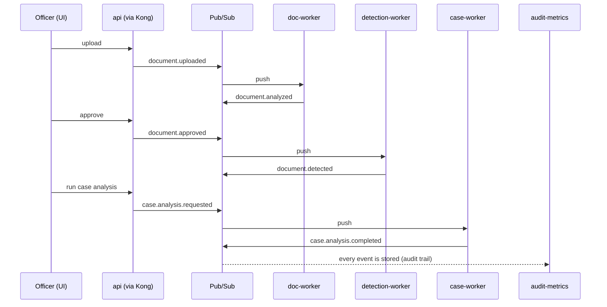

# The cloud architecture: a guide for presenting it

What we built on the `microservices` branch, how it works, and how to show it. The diagrams are in [`six-sevens-architecture.drawio`](six-sevens-architecture.drawio), one page per diagram:

1. System architecture
2. GCP infrastructure
3. Life of a document
4. Stuck work recovery
5. Observability and cost
6. CI and deploy

**Opening the diagrams:**
- **VS Code:** the "Draw.io Integration" extension (`hediet.vscode-drawio`) opens the file directly.
- **Browser:** app.diagrams.net → File → Open from → Device.
- **Slides:** export each page as PNG or SVG (File → Export as).

Details live in `CLOUD_ARCHITECTURE_PLAN.md` (design), `HOW_IT_WORKS.md` (behaviour) and `deploy/terraform/README.md` (operations).

---

## 1. The one-minute version

The fraud-detection backend used to be one FastAPI process doing everything. It's now **six services** that never call each other: they communicate only through **events on one Google Pub/Sub topic** and through shared state in Supabase.

1. **The officer uses the app.** An upload or an approval becomes an event.
2. **Workers pick up the events they subscribe to:**
   - doc-worker classifies and extracts;
   - detection-worker runs the fraud agents;
   - case-worker scores the case.
3. **Each worker publishes its result as another event.**
4. **audit-metrics stores every event,** which gives a complete audit trail for free.

It runs on **Cloud Run** (Stage 1), with everything defined in **Terraform**. **Kong** is the single front door. Deploys go through **GitHub Actions** without stored keys, and the system is observed through **Grafana, Managed Prometheus and Cloud Trace**. Stage 2 moves the same services to GKE with Argo CD; that's a configuration change, not a rewrite.

## 2. What to show, in order (about 15 minutes)

| # | Show | Where | Point to make |
|---|---|---|---|
| 1 | Diagram page 1 | draw.io | Six services, one topic, no direct calls; workers are private |
| 2 | Upload a document, approve it, run the case analysis | the frontend URL | The app behaves as before, but each step is now an event |
| 3 | Cloud Run service list | Cloud Console → Cloud Run | Each service is deployed and scaled on its own (and scales to zero) |
| 4 | Pub/Sub subscriptions and their filters | Cloud Console → Pub/Sub | Each worker gets only its event types; failures go to the dead-letter topic |
| 5 | The case's **Claude Cost** tab | the case page → Claude Cost | What each document and the analysis cost, from the audit trail |
| 6 | One trace for that upload | Cloud Console → Trace explorer | One trace crosses api → Pub/Sub → doc-worker → detection-worker |
| 7 | Grafana: Pipeline, Agents, Cost | the Grafana URL (admin) | Stage timings, per-agent cost and cache hit ratio, estimated against billed cost |
| 8 | Diagram page 4, then the recovery row on the Pipeline dashboard | draw.io, Grafana | Stuck work recovers itself; the system is resilient, not just split |
| 9 | Diagram page 6, plus a deploy run in Actions | GitHub → Actions | Every push is linted, type-checked, tested and security-scanned; a deploy rolls back on its own |
| 10 | `deploy/terraform/` | the repo | Everything above is code |

**Optional failure demo** (prepare it beforehand; it takes up to about 17 minutes): start a detection, then deploy (or stop the detection-worker revision) while it runs. Show the document coming back to "detected" with nobody touching it. The audit trail shows `recovery.requested` then `document.recovered`.

## 3. The services

| Service | Public? | Does | Triggered by |
|---|---|---|---|
| **api** | via Kong | Reads, login, officer commands, uploads, live updates over WebSocket, case match | HTTP |
| **audit-metrics** | via Kong (`/audit`) | Stores every event; serves the audit trail and per-case cost; runs the sweeper | Every event (push) |
| **doc-worker** | private | OCR, classify, extract (LangGraph + Claude) | `document.uploaded`, `retyped`, `retry_requested`, `cancelled` |
| **detection-worker** | private | Lead agent plus 3 specialists over 10 fraud checks; writes flags | `document.approved`, detection retry and cancel |
| **case-worker** | private | Cross-document analysis, deterministic risk score, summary | `case.analysis.requested` |
| **Kong** | public | The single entry point: CORS, rate limits, request ids; blocks `/push` and `/metrics` | HTTP |

Also deployed: the **frontend** (React build in nginx) and **Grafana**.

**One codebase, one Dockerfile.** Every backend service is the same code started with a different `ROLE`. Locally, `uvicorn` runs every role in one process with in-process events, so daily development is unchanged.

## 4. How a request flows (diagram page 3)

The UI updates live: Supabase Realtime tells api a row changed, and api pushes a fresh snapshot over the open WebSocket.

## 5. How each cloud-native requirement is met

| Requirement | How |
|---|---|
| **Genuinely decoupled** | No service calls another. The contract is the event envelope on one topic. Each service can be deployed, scaled and failed on its own. |
| **Independent scaling** | Cloud Run per service: workers have 2 vCPU and 4 GiB and scale on pushes; api scales up to 3; everything scales to zero when idle. |
| **Resilience** | Pub/Sub redelivers, and dead-letters after 5 attempts. Handlers are idempotent with compare-and-swap status changes. A sweeper recovers stuck work. A deploy rolls back automatically when its checks fail. |
| **Infrastructure as code** | Terraform: services, IAM, secrets, Pub/Sub, scheduler, monitoring, alerts, billing export, Grafana. |
| **Secure delivery** | CI runs ruff, pyright (no suppressions allowed), pytest, Playwright, Checkov, and Snyk or pip-audit. Deploys use Workload Identity Federation, so no stored keys. |
| **Least privilege** | A service account per service; secrets readable only by the services that need them; workers callable only by Pub/Sub's signed identity. |
| **Observability** | Metrics from every service (Managed Prometheus), traces across services (Cloud Trace), four Grafana dashboards, email alerts, an audit trail of every action. |
| **Cost awareness** | Claude cost per agent, per document and per case; Cloud Run estimates live; actual GCP billing from the BigQuery export; a budget alert and a daily Claude spend alert. |

## 6. Questions to ask the professor

1. **Does Cloud Run with Pub/Sub count as "genuinely decoupled"** for the Cloud Native award, or does it have to be Kubernetes (Stage 2: GKE Autopilot and Argo CD) before November?
2. **Is the event-driven design (one topic, filtered subscriptions, audit trail from events) the right story to lead with,** or should the demo lead with the infrastructure?
3. **Is the failure demo (self-recovery) worth the time slot** in the final presentation?

## 7. Questions you may be asked

| Question | Answer |
|---|---|
| Why Pub/Sub and not services calling each other? | Calls couple availability: if the worker is down, the api fails. With events, work waits in the subscription and is delivered when the worker is back. Detection takes 1-2 minutes, which shouldn't hold a request open. |
| Why one codebase for six services? | Shared models and repositories without a shared-library release process. The boundary is the event, not the repo. Each service still has its own image, scaling, identity and deploy. |
| What if a worker crashes mid-run? | Pub/Sub redelivers the message (ack deadline 600 s). If the run left a document stuck, the sweeper asks the owner to recover it, up to 3 times, then marks it failed so the officer can retry. |
| What if an event is processed twice? | Status changes are compare-and-swap, so the second attempt finds the status already moved and does nothing. The audit trail ignores a repeated event id. |
| Why not Kubernetes now? | Cloud Run gives the same separation for less operating effort before the deadline. The code already has handler-plus-adapter workers, so GKE is Stage 2 configuration. |
| How do you know what it costs? | Every Claude call is priced per agent and recorded per run; the Cost dashboard shows estimates live and Google's billed amount from the billing export. |
| What's not done? | Automatic case analysis (this sprint), a shared Anthropic rate limit across instances, the Stage 2 move, and the items in `PENDING_WORK.md`. |

## 8. Limits to be upfront about

- **All test documents are synthetic.** GLDB can't share real ones, so detection is tested on fraud we injected ourselves.
- **Cloud Run, not Kubernetes yet** (the open question above).
- **Some numbers are estimates:** Claude cost uses list prices, and the live Cloud Run cost is estimated. The billed row is exact but a few hours behind.
- **The `/dashboard` page in the app is still mock data** (being built separately). The Claude Cost tab on the case page is real data but a placeholder design.

## 9. Key facts at a glance

- **Region:** `asia-southeast1`. **Project:** `fyp-six-sevens`.
- **Services:** 6 backend roles (api, audit-metrics, doc-worker, detection-worker, case-worker; ingestion runs inside api), plus Kong, the frontend and Grafana. That's 8 Cloud Run services.
- **Messaging:** 1 topic and 4 filtered push subscriptions, plus a dead-letter topic and a sweep every 2 minutes.
- **Observability:** 4 Grafana dashboards and 4 alert policies.
- **Tests:** about 1,760 backend test functions and 107 Playwright tests, run in CI on every push.
